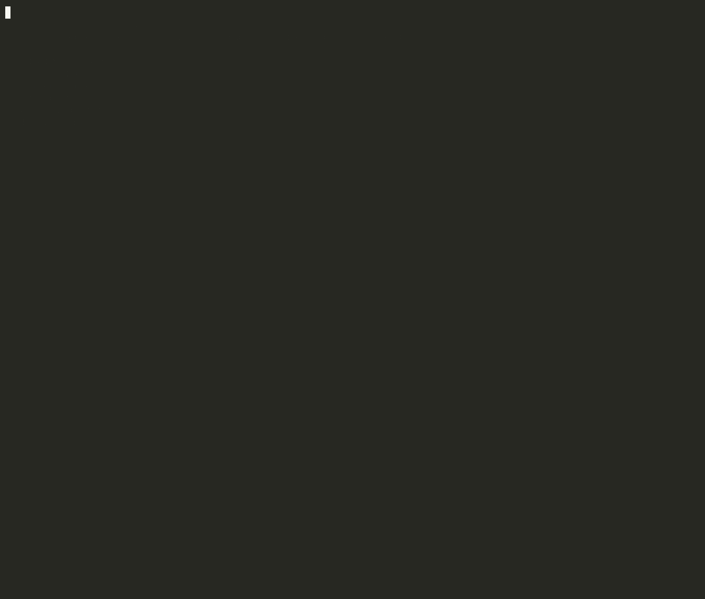
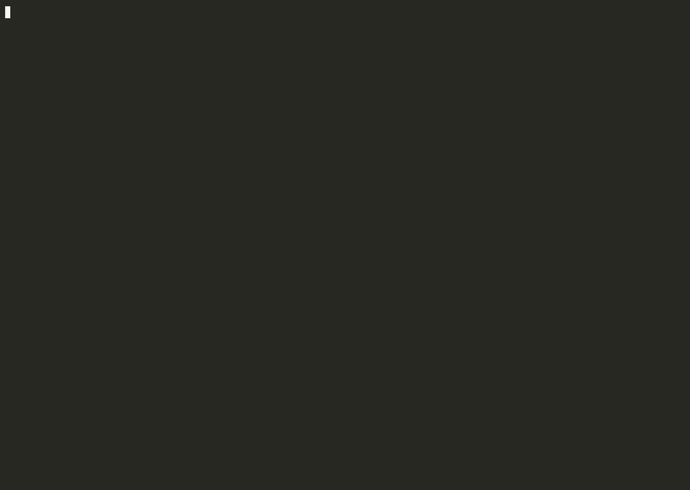

# strafrecht-rag

    

Retrieval-augmented generation over Dutch criminal-law rulings from
[Rechtspraak.nl Open Data](https://www.rechtspraak.nl/Uitspraken/paginas/open-data.aspx).
Ask a question in Dutch; get short claims, each one tied to the **ECLI, section and paragraph**
it came from. Every reference is verified in code against the passages that were actually
retrieved, and when the corpus has no relevant passage the system says so instead of answering.



*`strafrecht-rag ask` on the semantic question type: embedding, hybrid retrieval, cross-encoder
reranking, generation and source verification as separate stages, then the verified claims typed
out with their references. Also recorded: a [filtered question](docs/img/filtered.gif) (rechtbanken
only, from 2024), the [no-source path](docs/img/no-source.gif) and the
[evaluation run](docs/img/eval.gif). In the clips the model-loading and LLM stages are shortened
in post (`scripts/compress_cast.py`); everything else is real time on a laptop CPU.*

---

## The one rule

**No source, no answer.** A claim in an answer must end in a reference to a passage that was
supplied to the model, and any ECLI it mentions must belong to one of those passages. That rule is
not a prompt instruction the model may or may not follow; it is enforced after generation:

| Stage | What is enforced | Where |
|---|---|---|
| Retrieval | best relevance score (cross-encoder) below the threshold → the LLM is never called | `query/retriever.py` |
| Generation | numbered passages, one claim per line, `[n]` markers, `GEEN_BRON` allowed | `query/generator.py` |
| Verification | markers must point at supplied passages; unknown ECLIs reject the claim; unreferenced claims are dropped and reported. If nothing survives, the model gets one retry with a format reminder; what it produced is kept in the raw output | `query/generator.py::verify` |

The test suite includes a fake LLM that invents an ECLI and one that omits references; both are
rejected. The evaluation set contains questions that must hit the no-source path, so that path is
measured, not assumed.

## What it does

| Stage | Module | What happens |
|---|---|---|
| Ingest | `ingest/client.py` | Queries the Open Data search feed by date and subject (strafrecht), pages through results, downloads one XML per ECLI into `data/raw/`. Rate limited, retries with backoff, restart-safe (existing files are skipped). |
| Parse | `ingest/parser.py` | XML → one `Uitspraak`: ECLI, court, date, fields of law, procedures, case number, law references, the editorial summary, and ordered sections with numbered paragraphs. Lone bold headings inside a section become sub-sections, so a reference reads *§4.2 Waardering van het bewijs › Het oordeel van de rechtbank, par. 3*. One unparsable file is one error record, never a crashed batch. |
| Chunk | `index/chunker.py` | Pure and deterministic. Chunks never cross a section boundary and overlap by whole paragraphs; each carries ECLI, section and paragraph range. Chunk size is tied to the embedder's window (see decisions). |
| Embed + store | `index/embeddings.py`, `index/store.py` | Local ONNX model behind an `Embedder` interface (a hashed-bag-of-words `FakeEmbedder` runs the tests). The store is SQLite + NumPy: metadata and BM25 full-text search in SQLite (FTS5), vectors as one float32 matrix. Upserts are keyed on `ECLI#position`; unchanged documents are skipped on re-runs via a content fingerprint. |
| Retrieve | `query/retriever.py`, `index/reranker.py` | Hybrid: cosine top-3k and BM25 top-3k fused with reciprocal rank fusion, filters on court type, court name and date. A multilingual cross-encoder then reranks the top candidates and produces a calibrated relevance probability; the no-source threshold is on that number. At most two chunks per ruling in the top-k. |
| Generate + verify | `query/generator.py`, `query/llm.py` | LLM behind an interface: local Ollama (default), Claude via the Anthropic SDK, or an extractive fallback that quotes passages verbatim and needs no model. Output is parsed into claims and verified as described above. |
| CLI | `cli.py`, `ui.py` | `ingest`, `index`, `ask`, `eval`, `stats`, `demo`. `ask --json` gives the machine-readable answer the evaluation uses. |
| Evaluate | `eval.py` | Recall@k, hit@k, MRR, source correctness, claim acceptance and no-source correctness on `tests/fixtures/eval_vragen.json`. |

## Architecture

```mermaid
flowchart LR
    A[Rechtspraak.nl Open Data<br/>zoeken · content] -->|httpx, rate limited| B[data/raw/&lt;ECLI&gt;.xml]
    B --> C[parser<br/>Uitspraak: secties + paragrafen]
    C --> D[chunker<br/>560/120 chars, section-bound]
    D --> E[embedder<br/>multilingual MiniLM, 384d]
    E --> F[(SQLite + NumPy<br/>metadata · FTS5 · vectors)]
    Q[vraag] --> R[retriever<br/>cosine ⊕ BM25 · filters]
    F --> R
    R --> RR[cross-encoder rerank<br/>relevance 0–1 · drempel]
    RR -->|below threshold| N[GEEN BRON]
    RR -->|passages 1..k| G[LLM<br/>ollama · anthropic · extractive]
    G --> V[verify<br/>markers → passages, ECLI ∈ passages]
    V --> A2[Antwoord<br/>beweringen + verwijzingen]
    V -->|rejected claims| X[afgekeurd, reported]
```



## Quick start

Prerequisites: Python 3.12 and [uv](https://docs.astral.sh/uv/). No accounts, no keys: the
Open Data API is open access and the embedding and reranking models are downloaded once
(≈120 MB + ≈560 MB, into `~/.cache/fastembed`).
For generated answers you need either [Ollama](https://ollama.com) with a model pulled
(`ollama pull llama3.2`) or an `ANTHROPIC_API_KEY`; without either, use `--llm extractive`.

```bash
make install                  # .venv with everything, dev tools included
make test && make lint        # 93 tests, no network, no model, no LLM
make ingest                   # ≈ 1 900 rulings for the configured windows (≈ 20 min, resumable)
make index                    # parse + chunk + embed + upsert (≈ 120 min on a laptop CPU; re-runs skip unchanged rulings)
make ask Q="Welke uitspraken gaan over verduistering door een penningmeester?"
make eval                     # the numbers below
make demo                     # the four question types from the PRD, animated
```

Everything is configurable through `.env` (see `.env.example`): corpus windows, chunk size and
overlap, top-k, score threshold, embedding backend and model, LLM backend and model.

```bash
strafrecht-rag ask "Handel in vuurwapens en munitie" --type Rechtbank --van 2024-01-01
strafrecht-rag ask "Wat woog de rechter mee bij de strafmaat voor de woningoverval in Alteveer?" --json
strafrecht-rag ask "…" --llm extractive     # no model: quotes the best passages, still verified
```

## Corpus

Criminal-law rulings published on Rechtspraak.nl with a full text, for the first half of March in
three years (2023, 2024, 2025). Big enough for real retrieval, small enough to build on a laptop.

| | |
|---|---|
| Rulings | 1,906 (1,245 rechtbank, 416 gerechtshof, 132 Hoge Raad, 89 Parket bij de Hoge Raad, 24 other) |
| Parse errors | 0 |
| Chunks | 124,952 (560 chars, 120 overlap, section-bound) |
| Distinct courts | 22 |
| Index size | 473 MB SQLite |

The raw XML stays out of git (`data/`), and only the anonymised publication is used; nothing is
enriched or de-anonymised.

## Evaluation

`tests/fixtures/eval_vragen.json` holds 15 questions: 8 semantic (phrased differently from
the rulings on purpose), 2 with metadata filters, 2 about the content of one ruling, and
3 that have no answer in the corpus. Retrieval metrics need no LLM; the generation metrics
below were measured with `ollama/llama3.2`.



*The clip is `strafrecht-rag eval --no-llm` (retrieval metrics only, ≈ 1 min); the full run with
the LLM takes ≈ 20 min on this CPU and its output is in [`docs/eval_results.json`](docs/eval_results.json).*

| Metric | Value | Meaning |
|---|---|---|
| recall@6 | **93 %** | share of expected ECLIs among the rulings in the top-k |
| hit@6 | 100 % | at least one expected ECLI in the top-k |
| MRR | 0.94 | rank of the first expected ECLI |
| source correctness | **100 %** | answers whose every cited ECLI is one of the retrieved passages |
| claim acceptance | 89 % | raw LLM claims that survive verification (the rest are rejected and shown) |
| no-source correctness | **100 %** | unanswerable questions that hit the no-source path |
| false no-source | 0 % | answerable questions refused (lower is better) |

Source correctness is 100 % by construction: a claim with an unknown ECLI or without a reference
never makes it into an answer. The interesting number is claim acceptance, which shows how often
the model *would* have gone off the passages.

## Decisions

| Decision | Choice | Why |
|---|---|---|
| Corpus scope (OQ3) | strafrecht, 1–15 March 2023/2024/2025, all courts | measured volume: ≈ 620 rulings per window; three years gives date filters something to filter on and both court levels for the type filter |
| XML parser | stdlib `ElementTree`, namespace-agnostic, fixture-first | the schema varies by year and court; matching on local names and testing on recorded rulings (rechtbank and hof) isolates the quirks in one module |
| Sub-sections from bold headings | a lone bold/underlined paragraph splits a section | rulings put *Standpunt van de verdediging / Oordeel van de rechtbank* in bold rather than in `<section>` tags; splitting makes references and embeddings more precise |
| Chunking | characters, section-bound, paragraph overlap, 560/120 | the embedder sees at most 128 tokens (≈ 450 characters); a chunk of window + overlap means the part beyond the window is embedded as the start of the next chunk. BM25 still sees every character. |
| Embedding model (OQ1) | `paraphrase-multilingual-MiniLM-L12-v2` via fastembed (ONNX, quantized) | multilingual with Dutch, 118 M parameters, ≈ 13 chunks/s on a laptop CPU; larger models (e5-large, bge-m3) were an order of magnitude slower on this machine. Behind an interface, so swapping is configuration. |
| Vector store (OQ2) | SQLite + NumPy, exact cosine | tens of thousands of vectors: an exact scan is single-digit milliseconds, FTS5 gives BM25 for free, one file, no service, no platform-specific wheels (LanceDB and recent onnxruntime have no Intel-Mac wheels). |
| Hybrid retrieval | RRF over cosine and BM25 | Dutch legal vocabulary is exact (ECLI numbers, article numbers, place names); keyword search catches what the small embedder misses |
| Reranking | `jina-reranker-v2-base-multilingual` cross-encoder over the top 12 candidates | measured necessity: the bi-encoder's cosine is not calibrated (an unrelated question still scores 0.6 against some legal paragraph), so a cosine threshold cannot tell "no source" from "source". The cross-encoder can; it costs a few seconds per question on CPU and only touches a dozen candidates. |
| No-source path | threshold on the reranker's relevance probability, before the LLM | makes "no answer" a property of retrieval; the LLM may additionally answer `GEEN_BRON`, and both cases are reported with the reason |
| Source verification | in code, after generation | prompt instructions are not a guarantee; markers are resolved to passages, unknown ECLIs reject the claim, and rejected claims are shown rather than hidden |
| Generation LLM (OQ4) | Ollama `llama3.2` by default, Claude optional, extractive fallback | no key needed for the default; the extractive backend keeps the whole chain (eval included) runnable without any model |
| Package layout | one package `strafrecht_rag` with `ingest/`, `index/`, `query/` | same shape as PRD §5.3, but importable and installable as a console script |

## Development

```bash
make ci        # exactly what the GitHub workflow runs: ruff check, ruff format --check, pytest
make fmt       # autofix
```

Tests use recorded XML (`tests/fixtures/ecli_*.xml`, `zoek_*.xml`), the `FakeEmbedder` and a
`FakeLLM`: no network, no model download, no LLM in CI.

```
strafrecht-rag/
├── src/strafrecht_rag/
│   ├── ingest/        client.py · parser.py · model.py
│   ├── index/         chunker.py · embeddings.py · store.py · main.py
│   ├── query/         retriever.py · generator.py · llm.py · answer.py
│   ├── cli.py · ui.py · eval.py · runtime.py · config.py
├── tests/             fixtures/ (XML, eval_vragen.json) + 93 tests
├── scripts/           eval.py · record.sh (asciinema + agg) · compress_cast.py
├── docs/              PRD, commit plan, checklist, img/ (GIFs and their last frames)
└── data/              raw/ · parsed/ · index/   (not in git, ≈ 1.1 GB after ingest + index)
```

## Disclaimer

Geen juridisch advies. Dit is een zoek- en samenvattingshulpmiddel over gepubliceerde,
geanonimiseerde uitspraken; controleer elke bron via de ECLI op rechtspraak.nl.
